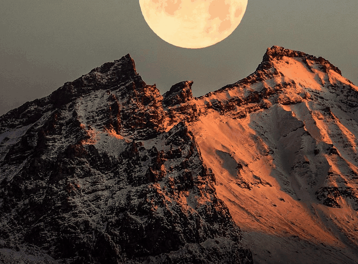
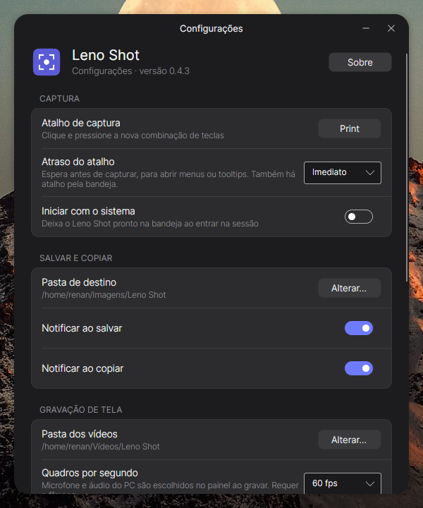

# Leno Shot

Captura de tela minimalista para Linux (X11). Selecione uma área, anote na hora e copie, salve ou grave em vídeo — tudo em uma única sobreposição, sem abrir um editor separado.

Feito com [Avalonia](https://avaloniaui.net/) e .NET 10, compilado com Native AOT (inicia rápido e usa pouca memória).

## Como funciona

Aperte o atalho (padrão: **Print**), arraste para selecionar a área e use a barra de ferramentas que aparece junto da seleção.



A barra de ferramentas traz as anotações, as cores, desfazer, captura com rolagem, gravação, salvar e copiar:


## Recursos

- **Captura de área** em um ou mais monitores, com a imagem congelada enquanto você seleciona.
- **Anotações:** caneta, setas, retângulos, elipses, marcadores numerados, marca-texto, texto e pixelização, com paleta de cores e desfazer.
- **Copiar ou salvar** a captura com um clique, com notificação opcional.
- **Captura com atraso** (ex.: 5 segundos) para abrir menus e tooltips antes de capturar.
- **Captura com rolagem** para páginas e janelas longas, emendando tudo em uma única imagem.
- **Gravação de tela** da área selecionada em MP4, com microfone e áudio do PC, pausa, zoom (lupa no mouse) e desenho ao vivo.
- **Fica na bandeja** do sistema, pronto para o atalho; pode iniciar junto com a sessão.

## Configurações

Atalho de captura, atraso, pastas de destino (imagens e vídeos), quadros por segundo da gravação e início com o sistema.



## Instalação

Gere o pacote `.deb` e instale:

```bash
packaging/build-deb.sh
sudo apt install ./dist/leno-shot_*_amd64.deb
```

Dependências principais: `ffmpeg` e `pulseaudio-utils` (gravação), além de bibliotecas X11 (`libx11-6`, `libxtst6`, `libxinerama1`, ...), todas instaladas pelo `apt`.

## Uso pela linha de comando

```bash
leno-shot capture             # captura uma área
leno-shot capture --delay 5   # captura após 5 segundos
leno-shot settings            # abre as configurações
leno-shot about               # abre a tela Sobre
leno-shot quit                # encerra o app
```

Se o Leno Shot já estiver rodando, o comando é repassado à instância existente.

## Desenvolvimento

Requer o SDK do .NET 10.

```bash
dotnet run --project LenoShot
```

```
LenoShot/     código do app (projeto Avalonia)
packaging/    script que gera o .deb
docs/images/  imagens deste README
```

## Licença

[MIT](LICENSE) © 2026 Renan Nunes
