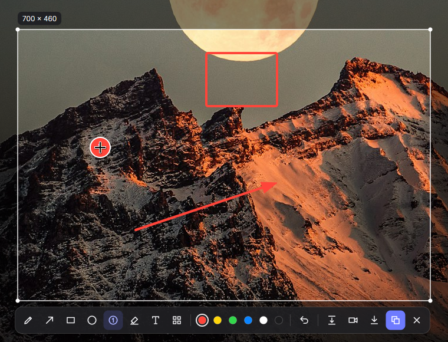

# LenoShot

Captura de tela minimalista para Linux (X11) e Windows 10/11. Selecione uma área, anote na hora e copie, salve ou grave em vídeo — tudo em uma única sobreposição, sem abrir um editor separado.

Feito com [Avalonia](https://avaloniaui.net/) e .NET 10, compilado com Native AOT (inicia rápido e usa pouca memória).

## Como funciona

Aperte o atalho (padrão: **Print**), arraste para selecionar a área e use a barra de ferramentas que aparece junto da seleção.


A barra de ferramentas traz as anotações, as cores, desfazer, captura com rolagem, gravação, salvar e copiar:



## Recursos

- **Captura de área** em um ou mais monitores, com a imagem congelada enquanto você seleciona.
- **Anotações:** caneta, setas, retângulos, elipses, marcadores numerados, marca-texto, texto e pixelização, com paleta de cores e desfazer.
- **Copiar ou salvar** a captura com um clique, com notificação opcional.
- **Captura com atraso** (ex.: 5 segundos) para abrir menus e tooltips antes de capturar.
- **Captura com rolagem** para páginas e janelas longas, emendando tudo em uma única imagem.
- **Gravação de tela** da área selecionada em MP4, com microfone e áudio do PC, pausa, zoom (lupa no mouse) e desenho ao vivo.
- **Fica na bandeja** do sistema, pronto para o atalho; pode iniciar junto com a sessão.

## Configurações

Atalho de captura, atraso, pastas de destino (imagens e vídeos), quadros por segundo da gravação e início com o sistema.


## Instalação

### Linux

Gere o pacote `.deb` e instale:

```bash
packaging/build-deb.sh
sudo apt install ./dist/lenoshot_*_amd64.deb
```

Dependências principais: `ffmpeg` e `pulseaudio-utils` (gravação), além de bibliotecas X11 (`libx11-6`, `libxtst6`, `libxinerama1`, ...), todas instaladas pelo `apt`.

### Windows

Gere o instalador `.exe` e instale:

```powershell
winget install JRSoftware.InnoSetup   # só na primeira vez
powershell -ExecutionPolicy Bypass -File packaging/build-windows.ps1 -Installer -NoAot
.\dist\LenoShot_0.4.3_win-x64-setup.exe
```

O instalador sai em `dist/LenoShot_<versão>_win-x64-setup.exe`, junto com uma pasta e um `.zip` (versão portátil: basta abrir o `LenoShot.exe`).

Variações do comando:

- **Sem `-NoAot`:** compila com Native AOT (executável menor e mais rápido), mas precisa das ferramentas de C++ do Visual Studio.
- **Sem `-Installer`:** gera só a pasta e o `.zip`, sem o Inno Setup.
- **Com `-NoFfmpeg`:** não inclui o ffmpeg (pacote bem menor, mas a gravação de tela depende de o usuário instalá-lo).

O instalador não pede administrador (instala em `%LOCALAPPDATA%\Programs\LenoShot`), cria o atalho no menu Iniciar, oferece iniciar com o Windows e aparece em "Aplicativos instalados" com desinstalador. Ao atualizar ou desinstalar, ele fecha o LenoShot se estiver aberto. Aceita os parâmetros silenciosos do Inno Setup (`/VERYSILENT`, `/TASKS=autostart`).

As ferramentas de C++ do Native AOT vêm com o Visual Studio (carga de trabalho "Desenvolvimento para desktop com C++"). Sem elas, `-NoAot` gera um executável único autocontido.

O ícone do `.exe` e do instalador fica em `packaging/LenoShot.ico`. Se o desenho do ícone mudar, gere de novo com `LenoShot --export-ico packaging/LenoShot.ico`.

O ffmpeg (usado na gravação de tela) já vai junto no instalador e no `.zip`: o script baixa o build "essentials" do [Gyan](https://www.gyan.dev/ffmpeg/builds/) uma vez, guarda em `dist/cache` e confere o SHA256. A licença dele (GPL) vai junto, como `ffmpeg-LICENSE.txt`. Com `-NoFfmpeg` ele fica de fora, e aí é preciso instalar à parte (`winget install Gyan.FFmpeg`).

Diferenças no Windows:

- O atalho **Print** funciona mesmo com a Ferramenta de Captura do Windows 11 ativada: o LenoShot fica com a tecla.
- Os atalhos ficam nas configurações do app (`%APPDATA%\LenoShot\settings.json`), não no sistema.
- O áudio do PC na gravação usa um dispositivo de loopback ("Mixagem estéreo" ou similar), que precisa estar ativado nas configurações de som. Sem ele, a gravação segue sem esse áudio, com um aviso.

## Uso pela linha de comando

```bash
LenoShot capture             # captura uma área
LenoShot capture --delay 5   # captura após 5 segundos
LenoShot settings            # abre as configurações
LenoShot about               # abre a tela Sobre
LenoShot quit                # encerra o app
```

Se o LenoShot já estiver rodando, o comando é repassado à instância existente.

## Desenvolvimento

Requer o SDK do .NET 10.

```bash
dotnet run --project LenoShot
```

```
LenoShot/     código do app (projeto Avalonia)
              Capture/Platform.cs escolhe X11 (Linux) ou Win32 (Windows)
packaging/    scripts que geram o .deb e o pacote/instalador do Windows
docs/images/  imagens deste README
```

## Licença

[MIT](LICENSE) © 2026 Renan Nunes
